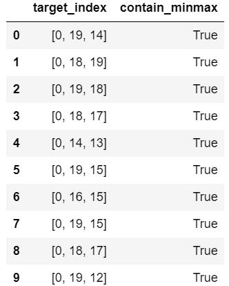
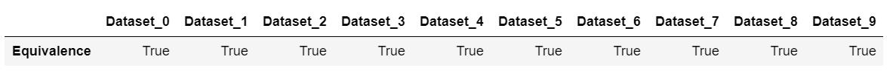
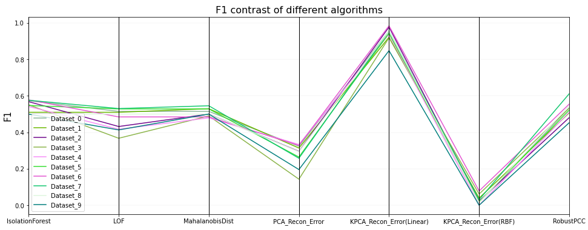
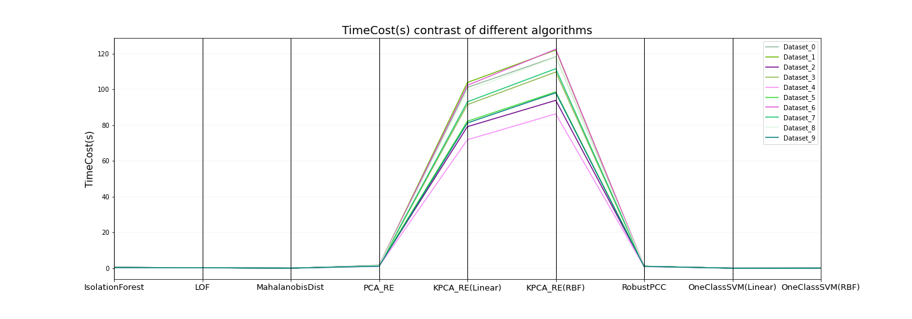
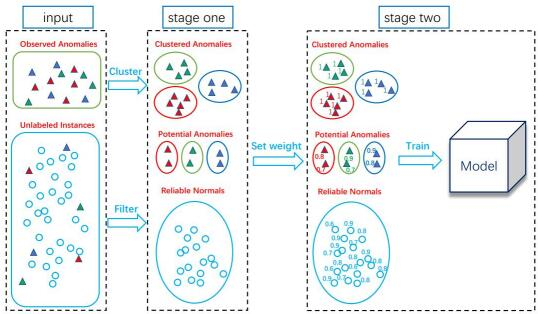
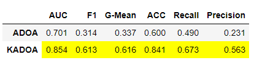
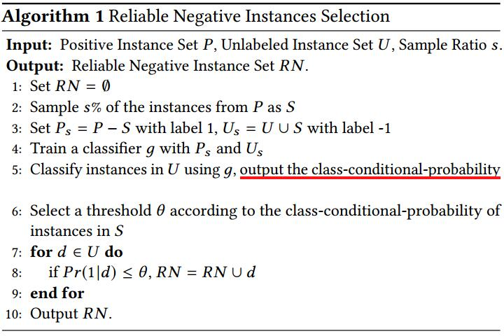
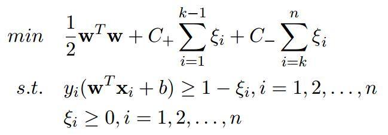
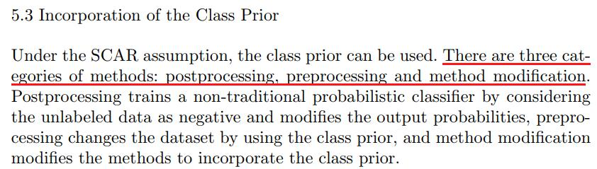
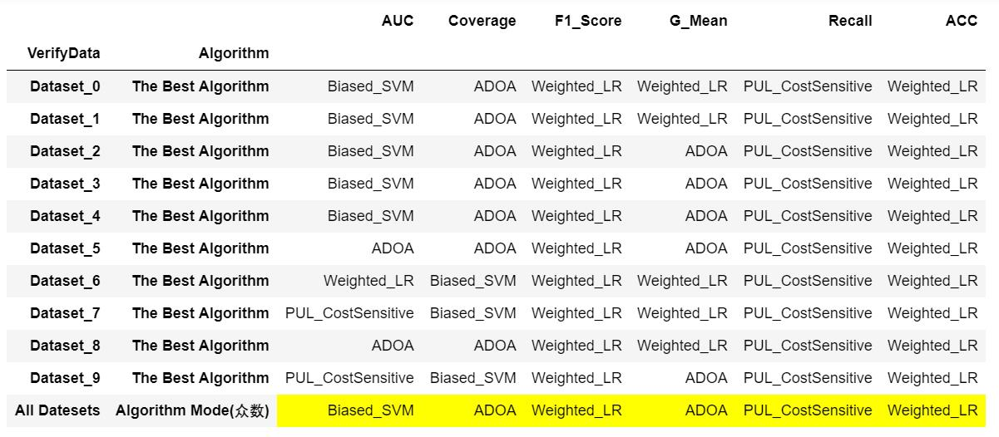

# Anomaly-Detection

[English](README.md) | [简体中文](README.zh-CN.md)

> **维护说明：** 本项目正在进行渐进式恢复维护。当前大部分脚本属于历史学习或研究实现，尚不是生产级算法库。原有中文讲解与手写代码将继续保留；后续改动会先补测试，再分阶段处理兼容性、稳定 API、公平基准和新算法。详见 [Revival Roadmap](ROADMAP.md)。

> **证据边界：** 本文历史图表和对比结果仅对应当时的数据生成方式、参数与实验范围。无真实标签时，与 Isolation Forest 的重合程度只能称为检测器一致性，不能当作准确率或普遍性能证明。

> **最小稳定 API（alpha）：** 当前首批只开放
> `MahalanobisDetector` 与 `PCAReconstructionDetector`。两者统一提供
> `fit(X)`、`score_samples(X)`、`predict(X)`；分数越高表示越异常，
> 预测标签约定为异常 `1`、正常 `0`。安装方式、阈值规则及与历史脚本的
> 对照测试见 [API contract and migration notes](docs/stable-api.md)。
> 原目录和手写实现均保留，RobustPCC 与 Kernel PCA 暂不承诺为稳定 API。

> **公平 benchmark：** 新评测入口见
> [benchmarks/README.md](benchmarks/README.md)。评测重新划分
> train/validation/test，并保证完全重复的特征行不会跨分区；标签仅用于分层划分、
> 验证集阈值校准和最终指标，检测器拟合不接收标签，测试分区标签也不参与阈值选择。
> 历史脚本和图片继续保留，不会被新结果覆盖。

- **Author：** MaXiao
- **E-Mail：** maxiaoscut@aliyun.com
- **备注：** 若文档无法正常显示图片，请参考右方链接： [github图片不显示的问题](https://zhuanlan.zhihu.com/p/107196957)
---

# 第一部分：无监督异常检测 (Unsupervised Detection)
## 1. 算法
### 1.1 Isolation Forest
- **算法论文：** [Isolation Forest [Liu et.al, 2008]](https://cs.nju.edu.cn/zhouzh/zhouzh.files/publication/icdm08b.pdf)
- **算法解析：** [Isolation Forest算法解析](https://github.com/Albertsr/Anomaly-Detection/blob/master/UnSupervised-Isolation%20Forest/ReadMe.md)
- **算法应用：** [isolationforest.py](https://github.com/Albertsr/Anomaly-Detection/blob/master/UnSupervised-Isolation%20Forest/IsolationForest.py)

### 1.2 基于PCA的异常检测
- **方法1：基于样本的重构误差**  
  - **算法论文：** [AI^2 : Training a big data machine to defend [Veeramachaneni et.al, 2016]](https://people.csail.mit.edu/kalyan/AI2/)
  - **算法解析：** [Chapter 1：基于样本的重构误差](https://github.com/Albertsr/Anomaly-Detection/blob/master/UnSupervised-Based%20on%20PCA/ReadMe.md#chapter-1基于样本的重构误差) 
    
  - **算法实现** 
    - **基于KernelPCA重构误差的异常检测：** [recon_error_kpca.py](https://github.com/Albertsr/Anomaly-Detection/blob/master/UnSupervised-Based%20on%20PCA/recon_error_kpca.py)
    - **基于LinearPCA重构误差的异常检测：** [recon_error_pca.py](https://github.com/Albertsr/Anomaly-Detection/blob/master/UnSupervised-Based%20on%20PCA/recon_error_pca.py)
    - **只调用Numpy实现LinearPCA异常检测：** [recon_error_pca_svd.py](https://github.com/Albertsr/Anomaly-Detection/blob/master/UnSupervised-Based%20on%20PCA/recon_error_pca_svd.py) 
       - 不调用scikit-learn，只调用Numpy，通过矩阵的奇异值分解(SVD)实现PCA，再进行异常检测
       - 返回结果与recon_error_pca.py完全一致

- **方法2：基于样本在Major/Minor主成分上的偏差**  
  - **算法论文：** [A Novel Anomaly Detection Scheme Based on Principal Component [Shyu et.al, 2003]](https://cn.bing.com/academic/profile?id=6ffacfce89595db316f3fd3bfeea1c1e&encoded=0&v=paper_preview&mkt=zh-cn)
  - **算法解析：** [Chapter 2：基于样本在major/minor主成分上的偏离程度](https://github.com/Albertsr/Anomaly-Detection/blob/master/UnSupervised-Based%20on%20PCA/ReadMe.md#chapter-2基于样本在majorminor主成分上的偏离程度) 
  
  - **算法实现：** [robustpcc.py](https://github.com/Albertsr/Anomaly-Detection/blob/master/UnSupervised-Based%20on%20PCA/robustpcc.py) 

  - **术语定义**
    - **major_eigen_vectors：将特征值降序排列后，累计之和占比约50%的前若干个特征值对应的特征向量** 
      - refers to the eigenvectors corresponding to the first few eigenvalues whose cumulative eigenvalues account for about 50% after the eigenvalues are arranged in descending order
    - **minor_eigen_vectors：特征值小于0.2对应的特征向量** 
      - refers to the eigenvectors corresponding to the eigenvalue less than 0.2
      
- **实证分析: 异常样本在最前、最后的若干主成分上具有最大的方差**

  - **分析：** [Chapter 3. 实证分析：异常样本在最前、最后的若干主成分上具有最大的方差](https://github.com/Albertsr/Anomaly-Detection/blob/master/UnSupervised-Based%20on%20PCA/ReadMe.md#chapter-3-实证分析异常样本在最前最后的若干主成分上具有最大的方差)
  - **验证代码：** [max_ev_decrease.py](https://github.com/Albertsr/Anomaly-Detection/blob/master/UnSupervised-Based%20on%20PCA/max_ev_decrease.py)
  - **验证结果：** 
       - 在本仓库当时生成的多个随机数据集上，异常样本经常在最前和最后的若干主成分上呈现较大方差；这是历史实验观察，不是对所有数据集都成立的普遍证明。
      
       
      

### 1.3 马氏距离(Mahalanobis Distance)
- **算法解析：** 
  - [Mahalanobis Distance](https://github.com/Albertsr/Anomaly-Detection/blob/master/UnSupervised-Mahalanobis%20Distance/ReadMe.md#1-马氏距离)
  - [Mahalanobis Distance's Variant](https://github.com/Albertsr/Anomaly-Detection/blob/master/UnSupervised-Mahalanobis%20Distance/ReadMe.md#3-马氏距离的变体及其代码实现)
  - 在协方差矩阵可逆且数值分解稳定的条件下，本实现中的 PCA 分解形式计算 squared Mahalanobis distance。
  
- **算法实现：** 
  - **马氏距离的初始定义实现：** [mahal_dist.py](https://github.com/Albertsr/Anomaly-Detection/blob/master/UnSupervised-Mahalanobis%20Distance/mahal_dist.py)
  - **马氏距离的变体实现：** [mahal_dist_variant.py](https://github.com/Albertsr/Anomaly-Detection/blob/master/UnSupervised-Mahalanobis%20Distance/mahal_dist_variant.py)
  
- **实证分析：** 
  - **结论：** 在上述适用条件下，本实现的 PCA 分解形式与 squared Mahalanobis distance 数值等价
  - **推论：** 两种实现对样本异常程度给出一致排序；随机数据实验用于核对代码实现，不替代数学推导
  - **验证代码：** [verify_mahal_equivalence.py](https://github.com/Albertsr/Anomaly-Detection/blob/master/UnSupervised-Mahalanobis%20Distance/verify_mahal_equivalence.py)
  - **验证结果：**
  
    

### 1.4 局部异常因子(Local Outlier Factor) 
- **算法论文：** [LOF：Identifying Density-Based Local Outliers](https://cn.bing.com/academic/profile?id=95956f2ccd5a6941f3e71ccfb2988419&encoded=0&v=paper_preview&mkt=zh-cn)
- **算法解析：** [Local Outlier Factor算法解析](https://github.com/Albertsr/Anomaly-Detection/blob/master/UnSupervised-Local%20Outlier%20Factor/ReadMe.md)
- **算法应用：** [lof.py](https://github.com/Albertsr/Anomaly-Detection/blob/master/UnSupervised-Local%20Outlier%20Factor/LocalOutlierFactor.py)

---

## 2. 历史对比实验
### 2.1 对比方案
- **步骤一：** 生成一系列随机数据集，每个数据集的行数(row)、列数(col)、污染率(contamination)均从某区间内随机抽取
- **步骤二：** 各个无监督异常检测算法根据指定的contamination返回异常样本的索引(anomalies_indices)
- **步骤三：** 确定评价参照
  - 如果数据集中异常样本的索引已知（记为 observed_anomaly_indices），则将真实标签作为 ground truth
  - 如果数据集中异常样本的索引未知，则仅将 Isolation Forest 返回的异常样本索引作为参考检测结果，用于比较检测器之间的一致性
- **步骤四：** 确定性能评判标准
  - 若异常样本的索引已知(记为observed_anomaly_indices)，则以F1-Score作为评判标准
  - 若异常样本的索引未知，则比较算法预测结果与参考检测结果的共同索引个数；该结果只表示一致程度，不能证明哪个算法更准确
- **步骤五：** 不同数据集可能得到不同结果，因此需要在更多数据、重复随机种子和明确评价协议下核验，不应据少量合成数据形成普适算法排名

### 2.2 对比代码 
- **Python代码：** [unsupervised_detection_contrast.py](https://github.com/Albertsr/Anomaly-Detection/blob/master/Algo%20Contrast/unsupervised_detection_contrast.py) (Jupyter交互式运行代码能更直观地展示验证过程)

### 2.3 对比结果
- **以下为 10 个随机合成数据集上的历史实验结果，仅对应当时的数据构造、参数和评价方式：**
  - **F1 Score**

    
  
  - **Time Cost**
     
    
     

### 2.4 对比分析
#### 1）RobustPCC
- RobustPCC重点考察了样本在major/minor Principal Component上的偏差，论文作者认为异常样本在主成分空间内的投影主要集中在上述两类主成分上
- RobustPCC在构建过程中，需要通过马氏距离(变体)检测并剔除数据集中一定比例(gamma)的潜在异常样本，以保证RobustPCC的有效性
- RobustPCC需要根据指定的分位点参数(quantile)来设定样本异常与否的阈值，**个人在实验中适度增大了gamma、quantile的取值，进一步降低FPR，提升鲁棒性**
- 在当前合成实验和参数设置下，RobustPCC 表现较好；这一观察仍需在更广泛数据集和重复实验中验证

#### 2）Recon_Error_PCA/KPCA  (Reconstruction Error Based on PCA/KernelPCA)
- Recon_Error_KPCA引入核函数(对比实验取Linear、RBF)，无需显式定义映射函数，通过Kernel Trick计算样本在高维特征空间（希尔伯特空间）内的重构误差；
- KernelPCA 的核函数和参数需要根据数据结构调整；当映射与数据几何关系匹配时，高维特征空间可能增强正常样本与异常样本的可分性
  - 这一效果依赖 kernel、scaling、数据分布和参数设置，不保证异常样本在所有数据集上都更容易区分；

#### 3）Isolation Forest
- Isolation Forest（孤立森林）在当时的实验中表现相对稳定；当验证数据的真实异常索引未知时，本文曾将其预测值作为参考，用于比较其他检测器的一致程度，而不是判定真实性能

#### 4）Mahalanobis Distance
- Mahalanobis Distance（马氏距离）实际上考虑了样本在所有主成分上的偏离度；本文展示的相对排序仅对应当时的实验数据和参数

#### 5）Local Outlier Factor
- LOF考虑了局部相邻密度，它存在一定的局限性：对于相关性结构较特殊的异常样本(anomalies in terms of different correlation structures)的检测能力不足

#### **备注** 
  - **上述实验结论受到实验数据集的样本构成、样本数量等多方面因素的影响，不一定具备普适性**
  - **在实际运用中，需要根据数据集本身的特点予以灵活选择相应的异常检测算法**

---

# 第二部分：半监督异常检测 (Semi-Supervised Anomaly Detection)
## 1. 算法
### 1.1 算法一：ADOA
- **算法论文：** [Anomaly Detection with Partially Observed Anomalies [Zhang et.al]](https://cs.nju.edu.cn/zhouzh/zhouzh.files/publication/www18bw.pdf)
- **算法解读：** [ADOA算法解读](https://github.com/Albertsr/Anomaly-Detection/blob/master/SemiSupervised-ADOA/ReadMe.md)
- **算法实现：** [adoa.py](https://github.com/Albertsr/Anomaly-Detection/blob/master/SemiSupervised-ADOA/adoa.py) 【其中包含：用于返回聚类中心子模块 [cluster_centers.py](https://github.com/Albertsr/Anomaly-Detection/blob/master/SemiSupervised-ADOA/cluster_centers.py)】
   
   
   
### 1.2 算法二：KADOA（作者提出的实验性方法）
- **思路简介**
  - ADOA采用孤立森林与聚类相结合，KADOA运用KernelPCA重构误差替代孤立森林进行异常检测，其它思路与ADOA一致
  - 当前仓库未记录 KADOA 对应的正式论文、同行评审或独立验证信息

- **KADOA代码**
  - [kadoa.py](https://github.com/Albertsr/Anomaly-Detection/blob/master/SemiSupervised-KADOA-Original/kadoa.py)

- **KADOA与ADOA的性能对比**
  - **对比代码：** [compare_adoa_kadoa.py](https://github.com/Albertsr/Anomaly-Detection/blob/master/SemiSupervised-KADOA-Original/compare_adoa_kadoa.py)
   - **对比结果：** 在仓库所附的单次合成数据示例及相同参数设置下，KADOA 在所报告的若干指标上高于 ADOA；这一初步观察尚未经过多数据集重复实验、统计显著性检验、同行评审或独立验证，不能推广为普遍结论
   - **指标提醒：** 历史对比脚本中名为 `G-Mean` 的指标实现仍待复核，本轮仅修正文档结论，不改动算法代码
  
  

### 1.3 算法三：PU Learning
#### 1) PU Learning三大处理方法：[PU Learning三大处理方法详细解读](https://github.com/Albertsr/Anomaly-Detection/blob/master/SemiSupervised-PU%20Learning/ReadMe.md)
  
- **方法一：Two step techniques**
   - **第一步：** 从U集中筛选可靠负样本RN（identifying reliable negative examples）
   - **第二步：** 基于已知正样本P、可靠负样本RN训练分类器（learning based on the labeled positives and reliable negatives）
    
    
    
- **方法二：Biased Learning**
  - 将U集视为带有噪音(即正样本)的负样本集（treat the unlabeled examples as negatives examples with class label noise）
  - 将正样本P、负样本U分别赋予相对更高、更低的正则化参数，使得混杂在U的noise允许被误分，这些被误分的noise实际上是真实的正样本
  - 常见的算法是Biased SVM，其优化问题如下
   
     

- **方法三：Class Prior Incorporation**
  - Class prior incorporation modifies standard learning methods by applying the mathematics from the SCAR（Selected Completely At Random） assumption directly, using the provided class prior. Additionally, methods for learning from relational PU data are discussed  
   
     
  
#### 2) 思路详解与代码实现  
- **思路一：Two Step Strategy + Cost-Sensitive Learning**
  - **算法论文：** [POSTER_ A PU Learning based System for Potential Malicious URL Detection [Zhang et.al]](https://cs.nju.edu.cn/zhouzh/zhouzh.files/publication/ccs17poster.pdf)
  
  - **算法解读：** [Two Step Strategy与 Cost-Sensitive Learning的结合](http://note.youdao.com/noteshare?id=594e87d6ac9e03d0bb461eb5160ffd7b&sub=781142FA6A634B44B3837CADCCCF74AC)
    - **Two Step Strategy：** [Two Step Strategy详解](https://github.com/Albertsr/Anomaly-Detection/blob/master/SemiSupervised-PU%20Learning/ReadMe.md#1-方法一two-step-strategy)   
    - **Cost-Sensitive Learning：** [Cost-Sensitive Learning详解](https://github.com/Albertsr/Class-Imbalance/blob/master/ReadMe.md)
 
  - **算法实现：** [pu_learning.py](https://github.com/Albertsr/Anomaly-Detection/blob/master/SemiSupervised-PU%20Learning/pu_learning.py)
  - **对sample_ratio的研究：** [sample_ratio](https://github.com/Albertsr/Anomaly-Detection/blob/master/SemiSupervised-PU%20Learning/ReadMe.md#附录关于spy-technique中抽样比例sample_ratio的总结)
  
- **思路二：Biased Learning**
  - **算法论文：** [Building Text Classifiers Using Positive and Unlabeled Examples [Liu et.al]](https://cn.bing.com/academic/profile?id=1252dfd9254eaa6059c5a1202548ee40&encoded=0&v=paper_preview&mkt=zh-cn)
  - **算法解读：** [Biased Learning解读](https://github.com/Albertsr/Anomaly-Detection/blob/master/SemiSupervised-PU%20Learning/ReadMe.md#2-方法二biased-learning)
  - **算法实现：** [biased_svm.py](https://github.com/Albertsr/Anomaly-Detection/blob/master/SemiSupervised-PU%20Learning/biased_svm.py)

- **思路三：Class Prior Incorporation**
  - **算法论文：** [Learning with Positive and Unlabeled Examples Using Weighted Logistic Regression [Lee et.al]](https://cn.bing.com/academic/profile?id=b4da94afa8e9a1e8d33ac97332c98b64&encoded=0&v=paper_preview&mkt=zh-cn)
  - **算法解读：** [Class Prior Incorporation解读](https://github.com/Albertsr/Anomaly-Detection/tree/master/SemiSupervised-PU%20Learning#3-方法三class-prior-incorporation)
  - **算法实现：** [weighted_lr.py](https://github.com/Albertsr/Anomaly-Detection/blob/master/SemiSupervised-PU%20Learning/weighted_lr.py)

---

## 2. 性能对比
### 2.1 对比算法
- **算法一：ADOA**
- **算法二：Biased SVM**
- **算法三：Weighted LR**
- **算法四：PU Learning +  Cost-Sensitive Learning**  
    
---

### 2.2 模型评估指标
- **历史脚本使用的模型评估指标：** ROC-AUC、F1 score、**weighted coverage**、**G-Mean（实现待复核）**、recall、accuracy

- **Coverage详解**
  - **出处：** [蚂蚁金服-风险大脑-支付风险识别大赛(第一赛季)](https://dc.cloud.alipay.com/index#/topic/data?id=4) 
  
  - **代码实现：** [coverage.py](https://github.com/Albertsr/Class-Imbalance/blob/master/5.%20Appropriate%20Metrics/coverage.py)
  
  - **定义：**
    

  
- **G-Mean**
  - **出处：** [Addressing the Curse of Imbalanced Training Sets: One-Sided Selection [Miroslav Kubat, Stan Matwin; 1997]](https://cn.bing.com/academic/profile?id=32c7b83b5988bbcad21fdeb24360d5c4&encoded=0&v=paper_preview&mkt=zh-cn) 
  
  - **代码实现：** [gmean.py](https://github.com/Albertsr/Class-Imbalance/blob/master/5.%20Appropriate%20Metrics/gmean.py)
  
  - **定义：** 
  
    
  
  
### 2.3 对比方案与代码
- **对比代码：** [semi_detection_contrast.py](https://github.com/Albertsr/Anomaly-Detection/blob/master/Algo%20Contrast/semi_detection_contrast.py)

- **对比思路：** 
  - **步骤一：** 生成一系列随机数据集，其中包含已观察到的**异常样本集(记为正样本集P)**，**无标签样本集(记为U)**
  
   - **步骤二：** 各个半监督异常检测算法**对U集进行预测并返回预测值y_pred**
    
   - **步骤三：** 生成U集时，其真实标签y_true是已知的，**根据y_true、y_pred计算半监督异常检测算法的性能**

   - **步骤四：** 不同的模型评估指标、不同的数据集对算法的性能有不同的评估，因此**根据多个随机数据返回多个模型评估指标对应的值，再进行比较**

### 2.4 验证结果

- **对比结果：**
   - 备注：每一列表示以对应列名为模型评估指标时，在相应数据集上表现最优的算法
   - 示例：第1列以AUC作为评估指标，根据10个随机数据集的结果取众数，Biased_SVM的表现是最佳的
   
   

- **解析**
  - **本次历史实验观察到：各半监督异常检测算法表现各有侧重，其中 PUL CostSensitive 的 Recall 最高；这与对 FN 设置更高代价的机制一致，但仍需在更多数据与重复实验中验证**

- **备注** 
  - **上述实验结论受到实验数据集的样本构成、样本数量等多方面因素的影响，不一定具备普适性**
  - **在实际运用中，需要根据数据集本身的特点予以灵活选择相应的异常检测算法**

---

## 引用与许可证

- 如需在研究或教学中引用本仓库，请使用 [`CITATION.cff`](CITATION.cff) 中的软件引用信息；现阶段未声明 DOI、正式 release 版本或 KADOA 独立论文。
- 本项目采用 [MIT License](LICENSE)，版权年份为 2018-2026，版权所有者为 Ma Xiao。
